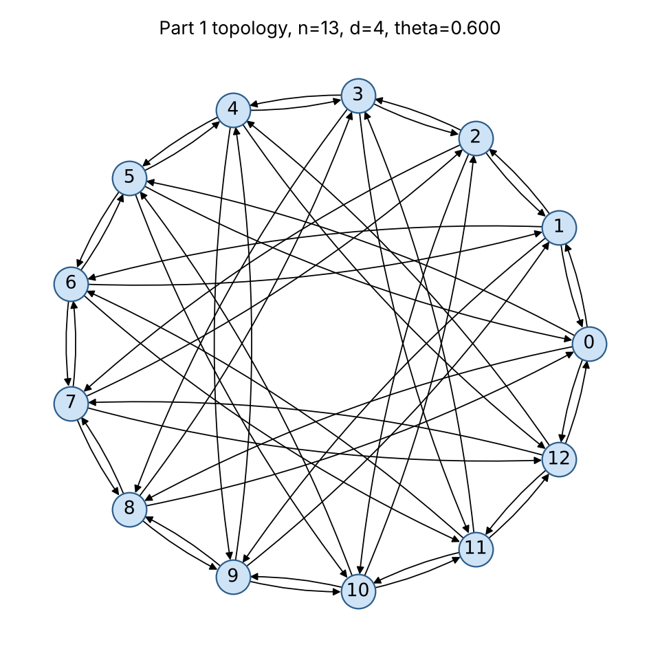

**Repository:** [https://github.com/philwisniewski/cs-422-assignment-4](https://github.com/philwisniewski/cs-422-assignment-4)

| What | Where |
|---|---|
| Part 1 construction (all candidates + selection) | [`src/part1_uniform.py` L48–176](https://github.com/philwisniewski/cs-422-assignment-4/blob/main/src/part1_uniform.py#L48-L176) |
| Cyclotomic Cayley digraph | [`src/part1_uniform.py` L102–125](https://github.com/philwisniewski/cs-422-assignment-4/blob/main/src/part1_uniform.py#L102-L125) |
| Moore bound, max-concurrent-flow LP | [`src/common.py` L16–153](https://github.com/philwisniewski/cs-422-assignment-4/blob/main/src/common.py#L16-L153) |
| **Part 2 Gurobi MILP** | [`src/part2_milp.py` L60–108](https://github.com/philwisniewski/cs-422-assignment-4/blob/main/src/part2_milp.py#L60-L108) |
| Robust (one topology, many TMs) variant | [`src/part2_milp.py` L111–145](https://github.com/philwisniewski/cs-422-assignment-4/blob/main/src/part2_milp.py#L111-L145) |
| Hose traffic-matrix generators | [`src/hose_tms.py`](https://github.com/philwisniewski/cs-422-assignment-4/blob/main/src/hose_tms.py) |

**Setting and notation.** A topology is a directed multigraph $G$ on $n$ nodes in which every node has $d$ outgoing and $d$ incoming links of capacity 1; $x_{ij}\in\mathbb{Z}_{\ge 0}$ is the number of links $i\to j$. For a traffic matrix $T$, the *maximum concurrent flow* $\theta^*(G,T)$ is the largest $\theta$ such that $\theta T$ can be routed simultaneously (splittable, multipath) without exceeding any link capacity. $\mathrm{dist}_G(s,t)$ is the hop distance and $\bar L(G)=\frac{1}{n(n-1)}\sum_{s\neq t}\mathrm{dist}_G(s,t)$ the average shortest-path length.

# Part 1 — Uniform traffic matrix

## 1.1 Upper bound: throughput is limited by path length

**Lemma 1 (capacity–hop-count bound).** For the uniform TM ($T_{st}=\frac{d}{n-1}$), every topology satisfies
$$\theta^*(G) \;\le\; \frac{1}{\bar L(G)}.$$

*Proof.* A unit of traffic from $s$ to $t$ crosses at least $\mathrm{dist}(s,t)$ links, so it consumes at least $\mathrm{dist}(s,t)$ units of link capacity. Summing over all demands and comparing with the total capacity $nd$ of the network:
$$\theta\sum_{s\ne t}\frac{d}{n-1}\,\mathrm{dist}(s,t)\;\le\; nd
\quad\Longrightarrow\quad
\theta \le \frac{n(n-1)}{\sum_{s\neq t}\mathrm{dist}(s,t)} = \frac{1}{\bar L(G)}. \qquad\blacksquare$$

**Lemma 2 (directed Moore bound).** From any node, at most $d$ nodes are at distance 1, at most $d^2$ at distance 2, …, at most $d^k$ at distance $k$. The sum of distances from a node is therefore at least the value obtained by filling these "shells" greedily:
$$\bar L(G)\;\ge\; \bar M(n,d)=\frac{1}{n-1}\sum_{k\ge1} k\,N_k,\qquad N_k=\min\Big(d^k,\;n-1-\textstyle\sum_{j<k}N_j\Big).$$

**Theorem.** For every $d$-regular topology, $\theta^*\le \min\{1,\;1/\bar M(n,d)\}$. A topology attains this bound **iff** (i) every node sees the Moore distance profile ($d$ nodes at 1 hop, then $d^2$, …) and (ii) the traffic can be routed on shortest paths only, with **every link exactly saturated**. These two conditions are the design goals: *short paths* and *perfectly balanced load*.

Example: $n=8,d=4$: $N_1=4,N_2=3$, so $\bar M=\frac{4+6}{7}=\frac{10}{7}$ and $\theta^*\le 0.7$.

## 1.2 Construction

The assumption $d\mid n-1$ is exactly what the following algebraic construction needs.

**Construction B — cyclotomic Cayley digraph** ($n$ prime, $d\mid n-1$).
The multiplicative group $\mathbb{Z}_n^*$ is cyclic of order $n-1$, so it has a unique subgroup $H$ of order $d$. Connect
$$i \;\to\; i+h \pmod n\qquad\text{for every } h\in H .$$

```
CYCLOTOMIC(n, d):                       # n prime, d divides n-1
    g  <- a generator of Z_n^*          # primitive root
    w  <- g^((n-1)/d) mod n             # element of order d
    H  <- { w^0, w^1, ..., w^(d-1) } mod n
    for i in 0..n-1:
        for h in H:  add link i -> (i + h) mod n
```

Example $n=13,d=4$: $H=\{1,5,8,12\}$; $n=7,d=3$: $H=\{1,2,4\}$.

*Why it is good.*

1. *Valid.* $|H|=d$ and $0\notin H$, so every node has $d$ distinct out-links, $d$ in-links, no self-loops.
2. *Perfect load balance (condition ii).* The maps $x\mapsto x+c$ (translations) and $x\mapsto hx$ for $h\in H$ (since $hH=H$) are graph automorphisms, and together they map any link onto any other link (the graph is **arc-transitive**). Take any shortest-path routing of the uniform TM and average it over all these automorphisms. Because the uniform TM is invariant under them, the averaged routing still routes the same demand on shortest paths, but now every link carries the same load: total load $/\,nd = \theta\cdot\frac{d}{n-1}\cdot n(n-1)\bar L/(nd)=\theta\bar L$. Setting $\theta=1/\bar L$ saturates every link exactly, so **$\theta^*=1/\bar L(G)$ — Lemma 1 is tight**.
3. *Distances come in blocks of $d$.* Since $x\mapsto hx$ fixes node 0, $\mathrm{dist}(0,x)=\mathrm{dist}(0,hx)$: the $n-1$ other nodes split into $(n-1)/d$ cosets of $H$, each lying at a single distance. When the cosets fill the Moore shells (e.g. one coset at distance 1 and all others at distance 2), condition (i) also holds and the graph is **provably optimal**. This happens e.g. for $(n,d)=(5,2),(7,3),(11,5),(13,4),(13,6),(19,6)$.

**Construction A** ($d=n-1$): the complete digraph, $\theta^*=1$ (optimal).

**Construction C — generalized Kautz (Imase–Itoh) + local search**, used for any $(n,d)$, including non-prime $n$ (such as $n=8$) and large $n$ where an abelian Cayley graph has paths that are too long:

```
KAUTZ_SEARCH(n, d):
    for i in 0..n-1, a in 1..d:  add link i -> (-d*i - a) mod n      # Imase–Itoh
    remove self-loops by degree-preserving swaps (u->u, c->e) => (u->e, c->u)
    repeat: pick links a->b, c->e, swap heads to a->e, c->b if no loop/duplicate;
            keep the swap if the average shortest path does not increase
    until avg path length == Moore bound or no improvement
```
Imase–Itoh graphs exist for every $(n,d)$, have diameter $\le\lceil\log_d n\rceil$, and are exactly Moore-optimal at Kautz sizes $n=d^k+d^{k-1}$; the swaps preserve all in/out degrees.

**Selection and certificate.** `build_topology` builds every applicable candidate, computes the true $\theta$ of each with the maximum-concurrent-flow LP, keeps the best, and refines it with the same head-swap move but now accepting a swap only if the LP $\theta$ does not decrease. The output is certified optimal whenever $\theta$ meets $1/\bar M(n,d)$.

## 1.3 Results

`python src/part1_uniform.py` (θ from the LP, bound $=1/\bar M$):

| $n$ | $d$ | Moore $\bar M$ | our $\bar L$ | θ bound | θ achieved | gap | winning construction |
|---|---|---|---|---|---|---|---|
| 5 | 2 | 1.500 | 1.500 | 0.667 | **0.667** | 0% | cyclotomic |
| 7 | 2 | 1.667 | 1.762 | 0.600 | 0.545* | 9.1% | Kautz + search |
| 7 | 3 | 1.500 | 1.500 | 0.667 | **0.667** | 0% | cyclotomic |
| 8 | 4 | 1.429 | 1.429 | 0.700 | **0.700** | 0% | Kautz + search |
| 9 | 2 | 2.000 | 2.042 | 0.500 | 0.488* | 2.4% | Kautz + search |
| 9 | 4 | 1.500 | 1.500 | 0.667 | **0.667** | 0% | Kautz + search |
| 10 | 3 | 1.667 | 1.722 | 0.600 | 0.578 | 3.7% | Kautz + search |
| 13 | 4 | 1.667 | 1.667 | 0.600 | **0.600** | 0% | cyclotomic |
| 13 | 6 | 1.500 | 1.500 | 0.667 | **0.667** | 0% | cyclotomic |
| 17 | 4 | 1.750 | 1.798 | 0.571 | 0.550 | 3.8% | Kautz + search |
| 19 | 6 | 1.667 | 1.667 | 0.600 | **0.600** | 0% | cyclotomic |
| 21 | 5 | 1.750 | 1.760 | 0.571 | 0.563 | 1.5% | Kautz + search |

Bold = provably optimal (meets the bound). \* For $(7,2)$ and $(9,2)$ we solved the exact Part 2 MILP with the uniform TM: its optimum is **0.5455** and **0.4878**, identical to our construction, so these are also optimal; the Moore bound is simply not achievable there (directed Moore graphs do not exist for $d\ge2$ and diameter $\ge2$, Plesník–Znám). For $(10,3)$ the MILP found 0.5876 within its time limit, so our graph is within 1.7% of the best known.

{width=48%}

# Part 2 — Arbitrary (hose) traffic matrix, $n=8$, $d=4$ — MILP

**Idea.** For a *given* $T$ we choose links and routing **jointly**: the number of links between each pair is an integer decision variable that plays the role of capacity in a standard multi-commodity flow LP. Maximizing $\theta$ over both gives the topology with the largest concurrent flow for that $T$; re-solving for each new $T$ is how the topology adapts to the traffic.

## 2.1 Formulation

Let $N=\{1,\dots,8\}$, $P=\{(i,j)\in N^2: i\ne j\}$ the possible links, $d=4$.

**Decision variables**

* $x_{ij}\in\{0,1,\dots,d\}$ for $(i,j)\in P$: number of unit links from $i$ to $j$ (topology; parallel links allowed, binary in the `--simple` variant).
* $f^s_{ij}\ge 0$ for $s\in N,(i,j)\in P$: flow on link $(i,j)$ that originated at source $s$ (routing; flows are aggregated per source, which is equivalent to per-pair commodities for max-concurrent-flow but needs only $n$ commodities instead of $n(n-1)$).
* $\theta\ge 0$: concurrent-flow factor.

**Objective:** $\displaystyle \max\ \theta$

**Constraints**
$$
\begin{aligned}
&\textstyle\sum_{j\ne i} x_{ij} = d && \forall i\in N &&\text{(1) out-degree}\\
&\textstyle\sum_{i\ne j} x_{ij} = d && \forall j\in N &&\text{(2) in-degree}\\
&\textstyle\sum_{j} f^s_{sj}-\sum_{i} f^s_{is} = \theta\sum_{t} T_{st} && \forall s\in N &&\text{(3a) source emits its demand}\\
&\textstyle\sum_{i} f^s_{iv}-\sum_{j} f^s_{vj} = \theta\, T_{sv} && \forall s,\ v\ne s &&\text{(3b) each destination keeps its share}\\
&\textstyle\sum_{s} f^s_{ij} \le x_{ij} && \forall (i,j)\in P &&\text{(4) capacity = number of links}\\
&f^s_{is}=0 && \forall s,\ i\ne s &&\text{(5) tightening (no flow back into its source)}\\
&x_{ij}\in\mathbb{Z}_{\ge0},\ f^s_{ij}\ge0,\ \theta\ge0
\end{aligned}
$$

**Why it captures the problem.** (1)–(2) say that $x$ is exactly a feasible topology: each node uses its $d$ transmitters and $d$ receivers (using all of them never hurts, so equality is w.l.o.g.). For a fixed $x$, (3)–(4) are precisely the max-concurrent-flow LP: (3) routes $\theta T_{st}$ from every $s$ to every $t$ along arbitrary (multi-hop, split) paths, and (4) forbids flow on links that do not exist and caps each link by its capacity. Hence the optimal value is $\max_{x \text{ feasible}}\theta^*(x,T)$ — the best topology for $T$ together with a routing achieving it. Size for $n=8$: 56 integer + 448 flow + 1 = 505 variables and 136 constraints, solved to proven optimality (MIP gap 0) in a few seconds on a laptop.

**Useful facts that check the model.** (a) For any $T$ whose row sums equal $d$, $\theta\le1$: source $s$ has only $d$ units of outgoing capacity for $d$ units of demand. (b) For a permutation TM the MILP puts all 4 links of each node directly to its destination and gets $\theta=1$. (c) For the uniform TM it returns $\theta=0.7=1/\bar M(8,4)$, matching Part 1.

## 2.2 Implementation (Gurobi Python API)

`best_topology_milp(T, d, simple, time_limit)` in `src/part2_milp.py` builds the model exactly as above (variables `x`, `f`, `theta`; constraint groups labelled (1)–(5) in the code) and returns $\theta$, the link matrix $x$ and the link loads. Every MILP solution is re-checked by solving the plain max-concurrent-flow LP on the returned topology. Commands:

```
python src/part2_milp.py                  # experiment suite below
python src/part2_milp.py --tm my_tm.csv   # best topology for your own 8x8 TM
python src/part2_milp.py --simple         # at most one link per pair
python src/part2_milp.py --robust 3       # one static topology for 3 TMs
```

## 2.3 Results

Hose TMs (row and column sums $=4$, zero diagonal), first sample of each family (`--seed 1`; the full output with two samples per family is in `results/part2_results*.json`). "Static" = the Part 1 uniform-optimal graph with optimal routing for the same TM. Every MILP closed with gap 0, i.e. these values are proven optima.

| Traffic matrix | θ MILP (adapted) | θ static Part 1 graph | gain | θ MILP `--simple` |
|---|---|---|---|---|
| uniform ($4/7$ per pair) | 0.700 | 0.700 | 1.00× | 0.700 |
| permutation (4 units to one node) | 1.000 | 0.544 | 1.84× | 0.611 |
| random mix of 3 permutations | 0.870 | 0.536 | 1.62× | 0.660 |
| random dense (Sinkhorn-scaled) | 0.832 | 0.598 | 1.39× | 0.728 |
| 2 clusters of 4 | 0.875 | 0.656 | 1.33× | 0.813 |
| 4 clusters of 2 | 1.000 | 0.500 | 2.00× | 0.625 |

Observations: the uniform TM is the hardest case for an adapted topology (every pair has demand, so most traffic must take 2 hops) and there the MILP and Part 1 agree; skewed TMs let the MILP place links directly where the demand is, up to $2\times$ more throughput than any fixed graph. Example: for "2 clusters of 4" the MILP builds two dense 4-node groups with a few links between them and reaches $0.875$.

**Extension — one topology for many TMs.** If the network cannot be reconfigured per TM, `robust_topology_milp` shares one $x$ among $K$ TMs, gives each its own routing $f^{k}$ and maximizes $z\le\theta_k\ \forall k$. On 3 random hose TMs it reaches $\theta=0.636$ for all three, versus $0.86$–$0.89$ when each TM gets its own topology — quantifying the value of adapting the topology to the traffic.
